<!--
  Abhay Tiwari | GitHub Profile README
  Place README.md, dark.svg and light.svg in the repository:
  https://github.com/abhaytiwari321
--><picture>
  <source media="(prefers-color-scheme: dark)" srcset="./dark.svg">
  <source media="(prefers-color-scheme: light)" srcset="./light.svg">
  
</picture><h1 align="center">Hi 👋, I'm Abhay Tiwari</h1>
<h3 align="center">Full Stack Developer | Information Technology Student</h3>

  

👨‍💻 About Me
- I am an Information Technology student.
- I am passionate about Full Stack Development.
- I enjoy learning modern technologies and building web applications.
🧰 Languages and Tools

  
  
  
  
  
  
  
  
  
  
  
  

📊 GitHub Activity

  
  

  

🤝 Connect with Me

  
  
  

<i>Thanks for visiting my profile! Feel free to connect.</i>

